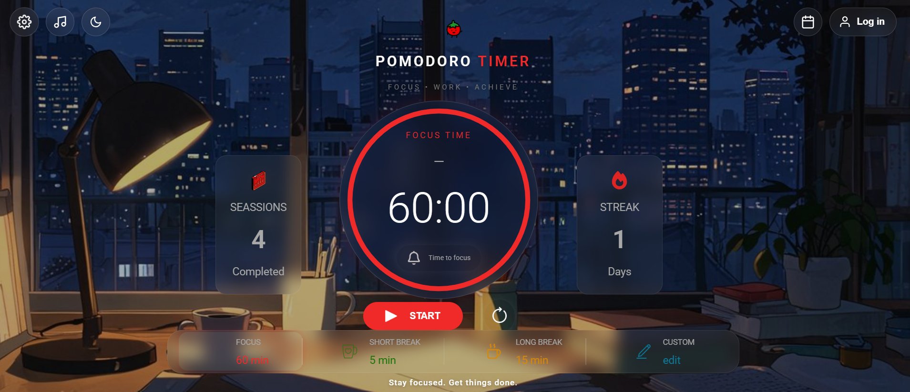
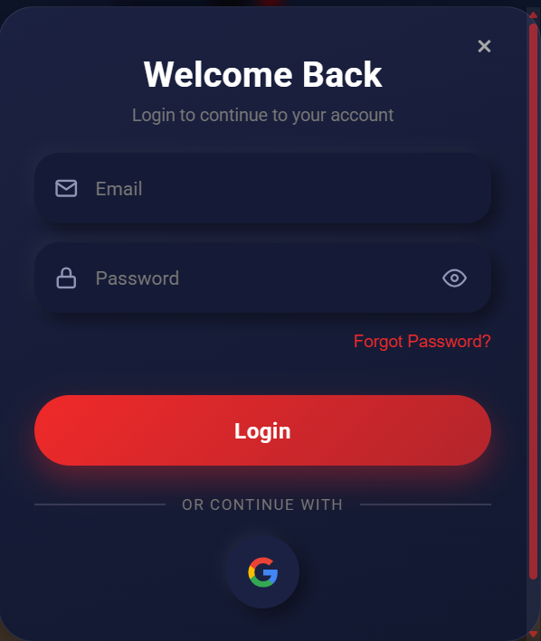
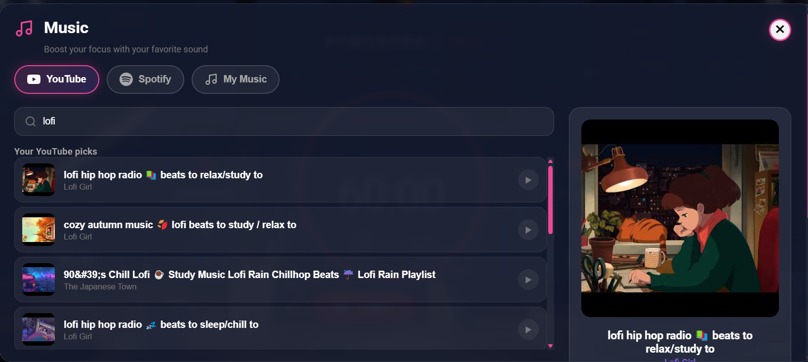
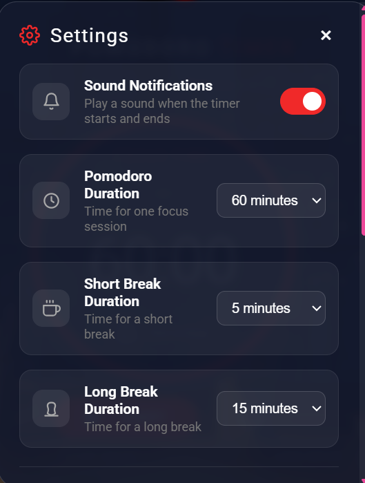

# 🍅 Pomodoro Timer

A focus timer built with plain HTML, CSS and JavaScript. It has a Pomodoro timer, a to-do list, a calendar, a music player and optional Google sign-in with cloud sync, all on one screen.

**Live demo:** https://telmahis.github.io/pomodoro-timer/



## Features

**Timer**
- Focus, short break and long break modes with a progress ring
- Remaining time shown in the browser tab title
- Browser notifications and sound cues when a session ends (the bell can be muted)

**Productivity**
- To-do list for the day's tasks
- Calendar with a history of completed sessions

**Music**
- Local tracks, YouTube search and Spotify links in one panel
- Play, pause, next, previous, shuffle and repeat, with auto-advance when a track ends
- Break music that starts and stops with the timer

**Personalisation**
- Dark and light themes
- Accent colour picker
- Background colours, or your own image (stored only in your browser)

**Accounts and sync**
- Sign in with Google
- Tasks, history and settings sync across devices with Firebase Firestore
- Works without an account too; data stays in your browser's local storage

## Screenshots

login


music


setting


## Built with

- HTML, CSS and vanilla JavaScript (ES modules), with no framework or build step
- Firebase Authentication and Cloud Firestore
- YouTube IFrame Player API and YouTube Data API v3

## Run it locally

1. Clone the repo:
   ```bash
      git clone https://github.com/telhamis/REPO-NAME.git
   ```
2. Open the folder in VS Code and start it with the **Live Server** extension. ES modules and Firebase need a local server, so opening the file directly won't work.
3. Open the address Live Server shows, for example `http://127.0.0.1:5500`.

## Project structure

```
index.html
style/      CSS (layout, theme, music panel, login)
scripts/    JavaScript (timer, features, music, login, Firebase)
sounds-noti/  notification and break sounds
photos/     icons and images
```

## Notes

- Some YouTube videos block embedding and can't play inside the player. Try another version of the song, for example one with "lyrics" or "audio" in the title.
- Music files in the repo should be ones you have the right to share.
